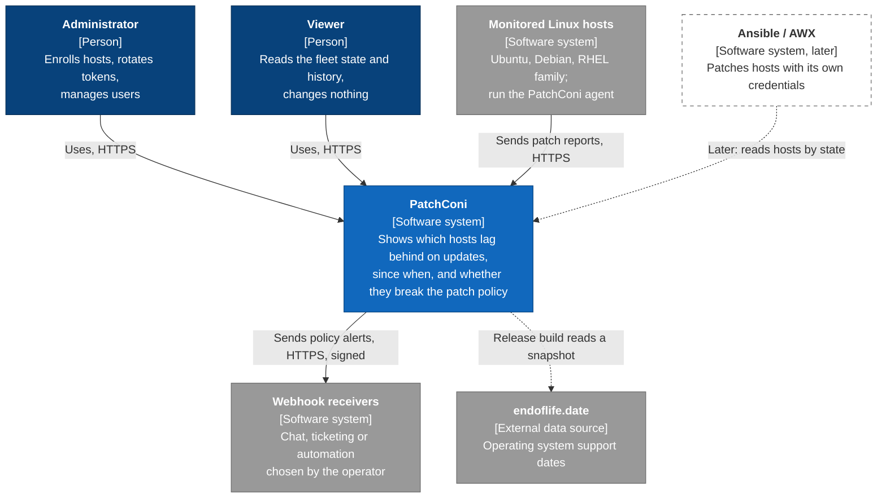
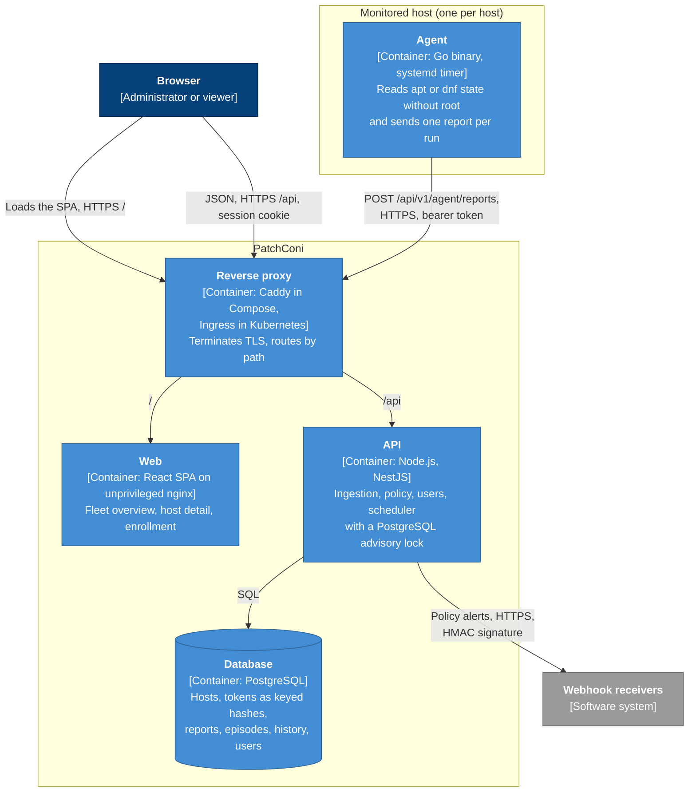

# Architecture

> Status: v1 (phase 1). It describes the target for v0.1.0; none of these components exists yet.

This document shows PatchConi with the first two levels of the [C4 model](https://c4model.com/): the **system context** (who and what PatchConi talks to) and the **containers** (the separately running pieces). The reasons behind each choice are in the [ADRs](adr/README.md); what a platform must provide to run PatchConi is in the [platform contract](platform-contract.md). The [threat model](threat-model.md) builds on these diagrams.

The diagrams use Mermaid `flowchart` with C4 notation, because Mermaid's own C4 diagram type is still [marked experimental](https://mermaid.js.org/syntax/c4.html). Notation:

- Each box names the element, its type in brackets and what it does.
- Arrows point in the direction the connection is opened, and are labeled with what travels and how.
- Dashed arrows are not part of v0.1.0: either they happen only when a release is built, or they are planned for later.

## Level 1: system context

| Element | Role | Defined in |
| --- | --- | --- |
| Administrator | Sam and Alex in the [vision](product/vision.md#who-it-is-for): enrolls hosts, rotates and revokes tokens, retires hosts, manages users. | [ADR 0005](adr/0005-better-auth-for-users.md), AC-1.x, AC-5.x |
| Viewer | Robin: sees everything and changes nothing; every write request returns `403`. | AC-5.2 |
| Monitored hosts | Each runs the agent. **The host always opens the connection**; PatchConi never connects to a host ([SECURITY.md](../SECURITY.md#scope)). | [ADR 0007](adr/0007-agent-in-go.md) |
| Webhook receivers | Any HTTPS endpoint the operator configures. Each message is signed with HMAC over a timestamp and the body. | AC-6.3, AC-6.4 |
| endoflife.date | Source of the lifecycle table. Read only when a release is built, never at run time: the server may have no internet access. | [Policy](product/policy.md#unsupported-operating-systems) |
| Ansible / AWX | Later: reads hosts by state (dynamic inventory) and, optionally, PatchConi starts one job template. That part gets its own ADR. | [Roadmap](product/roadmap.md#designed-now-built-later) |

## Level 2: containers

| Container | Responsibility | Defined in |
| --- | --- | --- |
| Agent | Go binary started by a systemd timer, as a dedicated unprivileged user (validated in phase 5). Read-only: never installs packages and never runs commands from the server. One run sends one report; there is no queue on disk. | [ADR 0007](adr/0007-agent-in-go.md), [protocol](product/protocol.md) |
| Reverse proxy | Terminates TLS and routes on one host name: `/api` to the API, `/` to the web. Caddy in the Compose example (planned, phase 2); in Kubernetes, the platform's Ingress controller. Not part of PatchConi's images. | [Platform contract §6](platform-contract.md#6-kubernetes-manifests) |
| Web | Static files built with Vite and served by nginx as a non-root user with a read-only root filesystem. Calls `/api` on the same origin, so no CORS. | [ADR 0003](adr/0003-web-react-vite-static-nginx.md) |
| API | The only component that talks to the database. Validates and applies agent reports, evaluates the policy, serves the UI, manages users and sessions (Better Auth) and runs the periodic jobs (policy evaluation, *no data*, webhooks, retention) under an advisory lock, so several replicas are safe. | [ADR 0005](adr/0005-better-auth-for-users.md), [ADR 0009](adr/0009-scheduler-inside-the-api.md), [domain model](product/domain-model.md) |
| Database | PostgreSQL, accessed through Drizzle. Migrations run as a separate one-off command, never at startup. | [ADR 0004](adr/0004-drizzle-orm.md), [platform contract §5](platform-contract.md#5-database-migrations) |

`/healthz`, `/readyz` and, from phase 7, `/metrics` are served by the API and are not drawn: `/metrics` is never routed through the public Ingress ([platform contract §3](platform-contract.md#3-health-and-metrics-endpoints)).

### Exposure

The proxy separates two audiences by path, and an installation should keep them apart:

- **Agents** only need `/api/v1/agent/`. That is the only path that has to be reachable from the hosts' networks.
- **People** use `/` and the rest of `/api`. The UI and the user API stay on an internal network or behind a VPN, never open to the internet: the dashboard is a list of hosts with their missing security updates.

How a platform enforces this (two Ingresses, an allowlist on the proxy, a VPN) is the platform's choice; the deployment sheet in phase 2 documents the paths. The platform contract currently asks for one Ingress for all of `/api`; letting the Kustomize base expose `/api/v1/agent/` on its own is [issue #38](https://github.com/andresBR8/patchconi/issues/38). The [threat model](threat-model.md) explains why (T-08).

## What runs where, and who opens each connection

| Connection | Opened by | Authentication |
| --- | --- | --- |
| Agent → proxy → API | The agent, on its timer | Per-host bearer token ([ADR 0006](adr/0006-per-host-agent-tokens.md)) |
| Browser → proxy → web, API | The person | Session cookie (Better Auth) |
| API → PostgreSQL | The API | Database credentials from a Secret |
| API → webhook receivers | The API scheduler | HMAC signature the receiver checks |
| Release build → endoflife.date | CI, when a release is built | None (public data) |

PatchConi never opens a connection to a monitored host.
