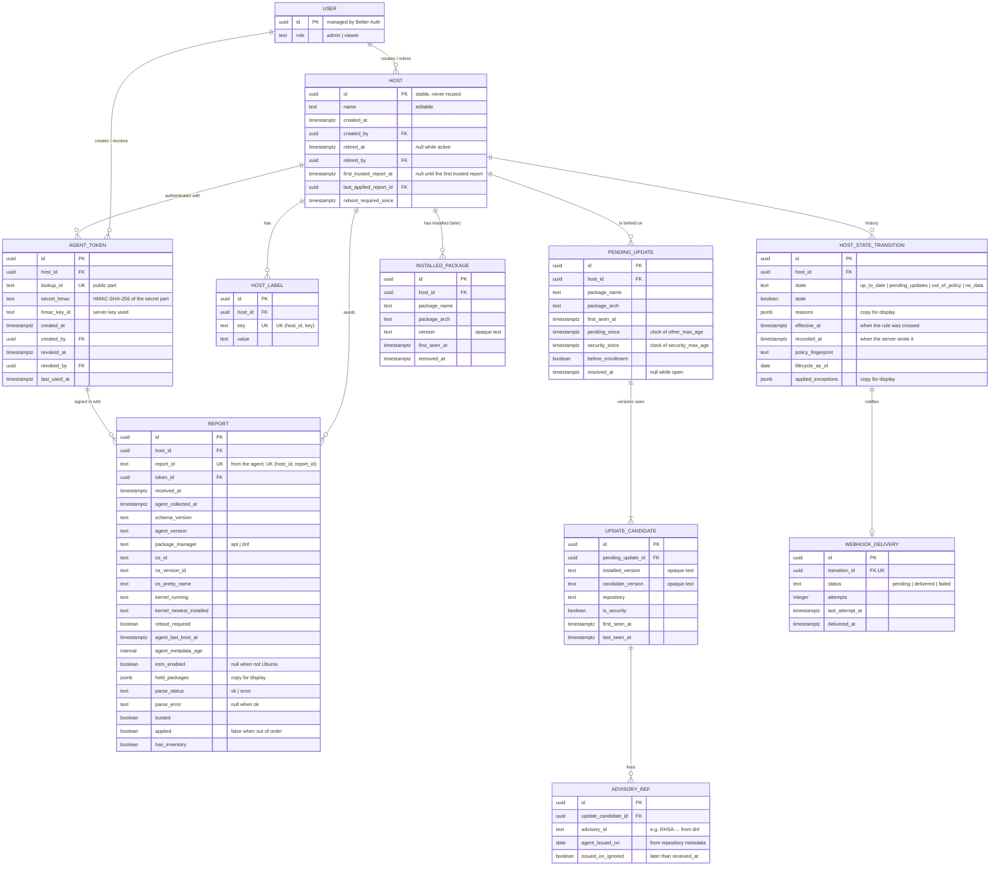

# Domain model

> Status: draft (phase 1). The database schema is built from this model in phase 3; column types and names may still change there, the rules may not without updating this document.

This document describes what PatchConi stores and why: the entities, how they relate, the rules that keep them consistent, and the words used for them everywhere else (UI, API, code). It is written so that every feature in the [roadmap](roadmap.md#designed-now-built-later) can be added later without a breaking change to the data.

## Overview

- A **host** is enrolled by an administrator and gets an **agent token**.
- The agent sends **reports**. Each report is stored as one row, without copying its package lists.
- What a report says about pending updates is folded into **pending update episodes**: one per host and package, open while an update for that package is pending, closed (*resolved*) when a trusted report no longer lists it. The episode carries the clocks of the [patch policy](policy.md).
- The **policy evaluation** turns the facts (episodes, the latest report, the host) into a state. Each change of state is recorded as a **state transition**: that is the history.
- The **policy**, its **exceptions** and the **lifecycle table** are not in the database: the first two are configuration ([ADR 0019](../adr/0019-patch-policy-as-code.md)), the third ships with each release.

## Entity-relationship diagram

Columns are those that carry meaning; every table also follows the [schema conventions](#schema-conventions-phase-3). Columns prefixed `agent_` are measured by the agent on the host (its clock or its machine); every other timestamp comes from the server clock.

## Entities

### Stored in the database

| Entity | What it is | Built in |
| --- | --- | --- |
| **User** | A person who logs in. The tables (`user`, `session`, `account`, `verification`) belong to Better Auth ([ADR 0005](../adr/0005-better-auth-for-users.md)); PatchConi adds only the role: *admin* or *viewer*. Users are deactivated, never deleted: `created_by`, `retired_by` and `revoked_by` point at them with `ON DELETE RESTRICT`, so the record of who did what survives the person leaving. How Better Auth supports deactivation (a ban, or a flag of our own) is checked in phase 3. | v0.1.0 |
| **Host** | A machine enrolled in PatchConi. Its `id` is generated by the server, never changes and is never reused, so configuration (exceptions) and integrations can point at it safely. The `name` is for people and can be edited; it is unique among active hosts (partial unique index on `name` where `retired_at` is null), so after a host is retired, a new host may take the same name. Hosts are retired, never deleted, so their history stays. | v0.1.0 |
| **Host label** | A `key=value` pair on a host (`env=prod`, `team=web`), unique per key. Key and value, rather than plain tags, because groups, per-group policies and Ansible inventory groups are selections by key. | v0.1.0 |
| **Agent token** | The credential an agent uses ([ADR 0006](../adr/0006-per-host-agent-tokens.md)). A host can have several over time (rotation) and, if [issue #14](https://github.com/andresBR8/patchconi/issues/14) accepts a grace period, two valid at once. `created_by` and `revoked_by` record who rotated or revoked it. | v0.1.0 |
| **Report** | One row per report received: who sent it, with which token and agent version, what the host is (operating system fields, kernels, reboot, ESM), how old its package metadata was, and whether parsing succeeded (AC-8.7). It does not copy the package lists: those go into episodes. | v0.1.0 |
| **Pending update** (episode) | One host behind on one package, identified by **name and architecture** (`libc6:amd64` and `libc6:i386` are two episodes). Open while any update for the package is pending; it carries *pending since*, *security since*, the *pending before enrollment* mark and, once closed, *resolved at*. | v0.1.0 |
| **Update candidate** | Each version offered for the package during the episode: installed and candidate version, repository, whether it is a security update, first and last seen. The open episode's most recent candidate is what the host detail shows. | v0.1.0 |
| **Advisory reference** | An advisory ID and date as reported for one candidate on one host. Not a shared table: if advisories were global, one compromised host could report a false date and change *pending since* on every other host. | v0.1.0 |
| **Installed package** | Optional inventory, stored as intervals (installed from, removed at) per host, name, architecture and version, with the same package identity as episodes. The report's optional inventory section is planned in protocol v1. | Later |
| **Host state transition** | A change of state, with the broken rules, whether the data was stale, the policy fingerprint, the lifecycle data date and a copy of the exceptions that applied. This is the history: the state on any past date is the last transition before it. | v0.1.0 |
| **Webhook delivery** | One notification per transition into *out of policy*. A unique transition per delivery prevents duplicates (AC-6.3). | v0.1.0 (*Important*) |

### Outside the database

| Entity | Where it lives | What it holds |
| --- | --- | --- |
| **Policy** | Configuration file and environment variables ([ADR 0019](../adr/0019-patch-policy-as-code.md)) | Thresholds and rules of the [patch policy](policy.md). |
| **Policy exception** | The same configuration file (later, see [below](#exceptions)) | A rule or a package skipped for one host until a date. |
| **Lifecycle table** | A data file built into each release | `snapshot_date`, and for each operating system and version, the end of vendor security support (and of ESM where it applies), from [endoflife.date](https://endoflife.date/). |

## How the facts are derived

### From a report to episodes

When a report is applied (see [ordering](#invariants-and-backend-rules)):

The rule is asymmetric: **any report whose parser succeeded can open episodes and add candidates; only a trusted report can close episodes.** What a report lists as pending is real even with old metadata (at worst the list is incomplete); a package missing from the list only means it was installed when the metadata is recent. If only trusted reports could open episodes, a host whose metadata refresh has been broken for weeks would show *no data* with security updates pending in plain sight, and *out of policy* would no longer win over *stale* ([policy](policy.md#states)).

1. **Trusted or not.** A report is *trusted* when its parser succeeded and its package metadata is within `metadata_max_age`.
2. **New pending package.** A package with no open episode opens one. `first_seen_at` is the server's receive time. `pending_since` is the earlier of that and any valid advisory date of its candidates.
3. **Already pending.** The open episode is kept; a new version adds a candidate, a known one updates `last_seen_at`.
4. **Security clock.** `security_since` is null until a security candidate appears; then it is the earlier of the first time a security candidate was seen and the valid advisory dates of the security candidates.
5. **Clocks only move earlier.** A new candidate's valid advisory date can move `pending_since` or `security_since` back, never forward. `pending_since` is always the minimum of itself and `security_since`: if a security candidate brings an advisory date earlier than the episode's `pending_since`, both clocks move back to it.
6. **First trusted report.** The host's first trusted report sets `first_trusted_report_at`, which is not recalculated when the policy changes later. Every episode still open after that report is applied, and with no valid advisory date on any of its candidates, is marked `before_enrollment`, including episodes opened by earlier reports with stale metadata. The clocks are not reset: they keep the first time the server saw the package pending.
7. **No longer pending.** A **trusted** report that does not list the package sets `resolved_at` to its receive time. A report whose parser failed, or whose metadata is too old, never resolves anything: with deleted package lists (`/var/lib/apt/lists`), the package manager lists nothing, and that would look like a fully patched host.
8. **Advisory dates** later than the report's receive time are kept with `issued_on_ignored` and play no part in the clocks ([policy](policy.md#how-pending-since-is-set)).

A report with a parser error (AC-8.7) is stored, updates the operating system fields, the kernels and the reboot flag, and neither opens nor closes episodes. The host detail shows the error.

A report whose `report_id` was already received from the same host is answered as a success and changes nothing (AC-2.4): an agent that retries after a lost response must not see an error.

### Reboot required

`reboot_required_since` is set from the server clock by the first applied report that says a reboot is required, and cleared by the first one that says it is not. Its history can be rebuilt from the reports in the retention window.

### From facts to a state

The state is computed by the policy evaluation, a pure function (see the [invariants](#invariants-and-backend-rules)). It is evaluated when a report arrives, by the scheduler ([ADR 0009](../adr/0009-scheduler-inside-the-api.md)) and when a state is read. **Reading never writes:** only ingestion and the scheduler record transitions. A read computes the state with the same function and stores nothing, so a viewer causes no writes and concurrent reads never race to record the same transition. Because `effective_at` is computed, the history stays exact even when the scheduler records a transition later than it took effect. When ingestion or the scheduler gets a result that differs from the host's last transition, a new transition is recorded:

- `effective_at` is when the change really happened, which the clocks make computable: `pending_since` + `other_max_age`, `security_since` + `security_max_age`, `reboot_required_since` + `reboot_max_age`, the last report's receive time + `stale_after`, the receive time of the report that changed the facts, or an exception's end date. If the server was down, `recorded_at` is later than `effective_at`, and the history still shows the right date.
- If several rules were crossed while nothing evaluated the host (the server was down), every intermediate transition is recorded, each with its own `effective_at`, so the state on any past date is exact.
- `policy_fingerprint` identifies the policy and exceptions in force, so a change of state caused by a new policy can be told apart from one caused by the host.

### Exceptions

Exceptions follow [ADR 0019](../adr/0019-patch-policy-as-code.md): they are configuration, not data edited in the UI, because an exception relaxes the policy. Built later ([roadmap](roadmap.md#designed-now-built-later)); the model already fixes their shape:

- Each exception has a unique `id`, the **host `id`** it applies to, what it skips (one rule, or one package name and architecture), a reason, an owner, `granted_at` and a **mandatory** `expires_at`.
- `expires_at` − `granted_at` cannot exceed `exception_max_duration` (90 days by default, configurable), so no exception is permanent. When the configuration is loaded, `granted_at` must not be in the future: otherwise an exception could be stretched by moving both dates forward.
- Exceptions point at the host `id`, not at its name or labels: a name or a label can change, or move to another host, without anyone noticing that the exception moved with it.
- When an exception ends, the host is evaluated again; if the state changes, the transition has `effective_at` = `expires_at`.
- Each transition keeps a copy of the exceptions that applied (`applied_exceptions`). A reviewer can see which exception covered a breach on a past date, even after it expired or was removed from the file.

## Invariants and backend rules

1. **Reports are applied in order, one host at a time.** Reports can arrive out of order (a host that was off, a retry) or at the same time (the agent's timer and a run after a package transaction). Ingestion for one host is serialized with a per-host lock in PostgreSQL (a row lock on the host or an advisory lock, as the scheduler uses in [ADR 0009](../adr/0009-scheduler-inside-the-api.md); chosen in phase 4). A report older than the last applied one is stored with `applied = false` and changes neither episodes nor state. The ordering mechanism (for example, a monotonic sequence number from the agent) is defined by the agent protocol in phase 1, step 5; this model only fixes the rule.
2. **One source of truth for the state.** The policy evaluation is a pure function of the domain: facts, policy, exceptions, lifecycle table and *now*, passed as a parameter, return a state and its reasons. It has no database access and no clock inside. Ingestion, reads and the scheduler all call it, so they always agree. Only ingestion and the scheduler record its output as transitions; a read returns the result without writing it.
3. **History only grows.** Resolved episodes and state transitions are immutable: if the package has an update pending again, a new episode is opened, and a correction is a new transition, never an edit of an old one. Only the retention job deletes them, in batches. Current facts do change in place: an open episode's clocks and candidates (`last_seen_at`), the host's `last_applied_report_id` and `reboot_required_since`, a token's `last_used_at` and revocation, a webhook delivery's attempts.
4. **Tokens are stored as keyed hashes.** Agent tokens are random with high entropy, so they are stored with HMAC-SHA-256 and a server key, not with bcrypt or Argon2, which are slow on purpose to protect low-entropy passwords. A token has a public part, used to find the row, and a secret part, whose HMAC is compared in constant time. `hmac_key_id` allows the server key to be rotated. The key is a new server secret: if it is lost, every agent token stops working. How it is supplied and rotated is decided in phase 4 (follow-up in [ADR 0006](../adr/0006-per-host-agent-tokens.md)).
5. **The server never compares versions.** `dpkg` and `rpm` have their own ordering rules (epochs, `~`, release tags). Versions are opaque text, compared only for equality. Whether an update is pending is decided by the package manager on the host.

## Schema conventions (phase 3)

- **Primary keys** are UUIDv7 generated by the server, in every table PatchConi owns. An identifier sent by a client (`report_id`) is never a primary key: it is a unique column scoped to its host. The exception is Better Auth's tables: `user.id` has the type Better Auth generates, checked against its current documentation in phase 3, and every column that points at a user (`created_by`, `retired_by`, `revoked_by`) uses that same type. A UUIDv7 reveals when it was created: a host ID in a policy file shows when the host was enrolled, which is acceptable.
- **Timestamps** are `timestamptz` in UTC. Names say whose clock it is: `agent_*` for anything measured on the host, everything else is the server clock.
- **NOT NULL by default.** A nullable column has a stated meaning, listed under [nullable columns](#nullable-columns). Invariants are `CHECK` constraints, for example `resolved_at >= first_seen_at`, `pending_since <= first_seen_at` and `pending_since <= security_since`. Closed sets of values are `text` with a `CHECK`, not PostgreSQL enums, which are harder to change in a migration.
- **Foreign keys** use `ON DELETE RESTRICT`. Hosts are retired and users deactivated, never deleted; the retention job deletes children before parents.
- **jsonb** only for copies and data that is displayed (`held_packages`, `reasons`, `applied_exceptions`), never for anything that is filtered on or joined.
- **Indexes** follow the main queries, and each one is confirmed with `EXPLAIN` in phase 3:
  - fleet overview: last transition per host (`host_id, effective_at DESC`);
  - open episodes of a host: partial unique index on `(host_id, package_name, package_arch) WHERE resolved_at IS NULL`, which also enforces one open episode per package;
  - reports of a host: `(host_id, received_at DESC)` and unique `(host_id, report_id)`;
  - history: transitions `(host_id, effective_at)`;
  - active host names: partial unique index on `name` `WHERE retired_at IS NULL`.
- **Validation in three layers:** the protocol schema at the API boundary (step 5), the invariants in the domain code, and the constraints in the database.

### Nullable columns

Every other column is `NOT NULL`.

| Column | Null means |
| --- | --- |
| `host.retired_at`, `host.retired_by` | The host is active. |
| `host.first_trusted_report_at` | No trusted report has arrived yet. |
| `host.last_applied_report_id` | No report has been applied yet. It must be nullable anyway: `report.host_id` points at the host, so the host row exists before its first report. |
| `host.reboot_required_since` | The last applied report did not require a reboot. |
| `agent_token.revoked_at`, `agent_token.revoked_by` | The token is not revoked. |
| `agent_token.last_used_at` | The token has never been used. |
| `report.esm_enabled` | Not applicable: the host is not Ubuntu. |
| `report.agent_metadata_age` | The agent could not measure it. Such a report is never trusted. |
| `report.parse_error` | The parser succeeded (`CHECK`: null exactly when `parse_status = 'ok'`). |
| `pending_update.security_since` | No security candidate has been seen in the episode. |
| `pending_update.resolved_at` | The episode is open. |
| `advisory_ref.agent_issued_on` | The advisory has no issued date. |
| `installed_package.removed_at` | The package is still installed. |
| `webhook_delivery.last_attempt_at`, `webhook_delivery.delivered_at` | Not attempted yet; not delivered yet. |

`applied_exceptions` and `held_packages` are never null: no value is an empty array.

## Retiring a host

Hosts are retired, never deleted. Retiring a host, by an administrator:

- sets `retired_at` and `retired_by`, and revokes all its tokens, so its next report is rejected with `401`;
- stops evaluating it and records no more transitions: a retired host has no state in the fleet overview, raises no webhooks and is not counted in the metrics;
- freezes its open episodes as they are. They are not resolved, because nothing was installed; they keep showing what was pending when the host left.

The host row stays for good, so its `id` is never reused. Its history (reports, resolved episodes and transitions) is pruned by retention like any other.

## Retention

History is kept for 90 days by default (configurable, AC-4.3). The retention job deletes, in batches:

- reports received before the window, except the last applied report of each host (it holds the current operating system and kernel);
- resolved episodes whose `resolved_at` is before the window, with their candidates and advisory references;
- transitions before the window, except the last one before it, so the state at the start of the window is known.

Open episodes are never deleted, however old: their clocks are the evidence. Rough size at the v0.1.0 target (200 hosts reporting every hour): 200 × 24 × 90 ≈ 432,000 report rows. That is why reports do not copy their package lists: with 20 pending updates per host, copies would be about 8.6 million rows.

## What v1 already allows

| Requirement ([roadmap](roadmap.md) and [vision](vision.md)) | Where in the model |
| --- | --- |
| *Resolved at* per update; exposure time | `pending_update.resolved_at` − `pending_since` (or `security_since`) |
| Host labels | `host_label` |
| Exceptions that expire | Configuration with a mandatory end date; `applied_exceptions` in each transition |
| Optional installed package inventory; watched software | `report.has_inventory`, `installed_package` (later), lifecycle table |
| Advisory ID and date; prioritization by exploited vulnerabilities | `advisory_ref` per candidate |
| *Pending before enrollment* | `pending_update.before_enrollment`, `host.first_trusted_report_at` |
| Report with a parser error (AC-8.7) | `report.parse_status`, `parse_error`; such a report never resolves episodes |
| Lifecycle snapshot and its date | Lifecycle table in the release; `transition.lifecycle_as_of` |
| 90-day history; state on a past date; exportable compliance report | `host_state_transition` with `effective_at`, plus episodes and reports in the window |
| Report after package changes | Ordering rule and `(host_id, report_id)` uniqueness |
| Remediation through integrations | Current state per host from the last transition; labels for grouping |

## Glossary

| Term | Meaning |
| --- | --- |
| **Advisory** | A vendor notice about an update (for example `RHSA-…`), with an ID and an issued date. In v0.1.0 only `dnf` reports advisories; `apt` does not. |
| **Applied report** | A report that was processed in order and changed the facts. An out-of-order report is stored but not applied. |
| **Enrollment** | Creating a host and issuing its first token. |
| **Episode** | See *pending update*. |
| **Exception** | A rule or a package skipped for one host until a date, declared in the policy configuration. |
| **First trusted report** | The first trusted report received from a host. Updates without an advisory date pending in it are marked *pending before enrollment*. |
| **Held package** | A package the host's administrator has pinned (`apt-mark hold`, `dnf versionlock`). |
| **Host** | A machine enrolled in PatchConi, identified by a server-generated ID that never changes. |
| **Label** | A `key=value` pair on a host. |
| **Lifecycle table** | The end-of-support dates of each operating system version, shipped with a release; its *snapshot date* is shown in the UI. |
| **Metadata age** | How old the host's package lists were when the agent ran, as measured by the agent. |
| **Pending before enrollment** | Mark on an update that is still pending when the first trusted report arrives and has no advisory date: its real age is unknown and its clocks are a lower bound. |
| **Pending since** | When the host started being behind on a package: the clock of `other_max_age`. |
| **Pending update** | One host behind on one package (name and architecture), from the first report whose parser succeeded and lists an update for it, until a trusted report no longer does. Also called an *episode*. |
| **Policy fingerprint** | An identifier of the policy and exceptions in force when a transition was recorded. |
| **Resolved at** | When a trusted report first stopped listing a pending package. |
| **Retired host** | A host taken out of the fleet: its tokens are revoked, it is no longer evaluated and its open episodes are frozen. The host row is kept for good; retention prunes its history like any other. |
| **Security since** | When the host started being behind on a security update for a package: the clock of `security_max_age`. |
| **Stale** | A host whose last report or package metadata is too old to trust. Shown as *no data*, or next to *out of policy*. |
| **State** | One of *up to date*, *pending updates*, *out of policy*, *no data* ([policy](policy.md#states)). |
| **State transition** | A recorded change of a host's state, with when it took effect and why. |
| **Trusted report** | A report whose parser succeeded and whose package metadata is within `metadata_max_age`. Any report whose parser succeeded can open a pending update; only a trusted report can resolve one. |
| **Unknown lifecycle** | An operating system that is not in the lifecycle table. Flagged, never *out of policy* on that account. |
| **Update candidate** | A version offered for a package during an episode. |
| **Valid report** | A report accepted by the protocol schema at the API (AC-2.1, AC-2.2). It may still carry a parser error (AC-8.7) or stale metadata: valid is not the same as trusted. |
